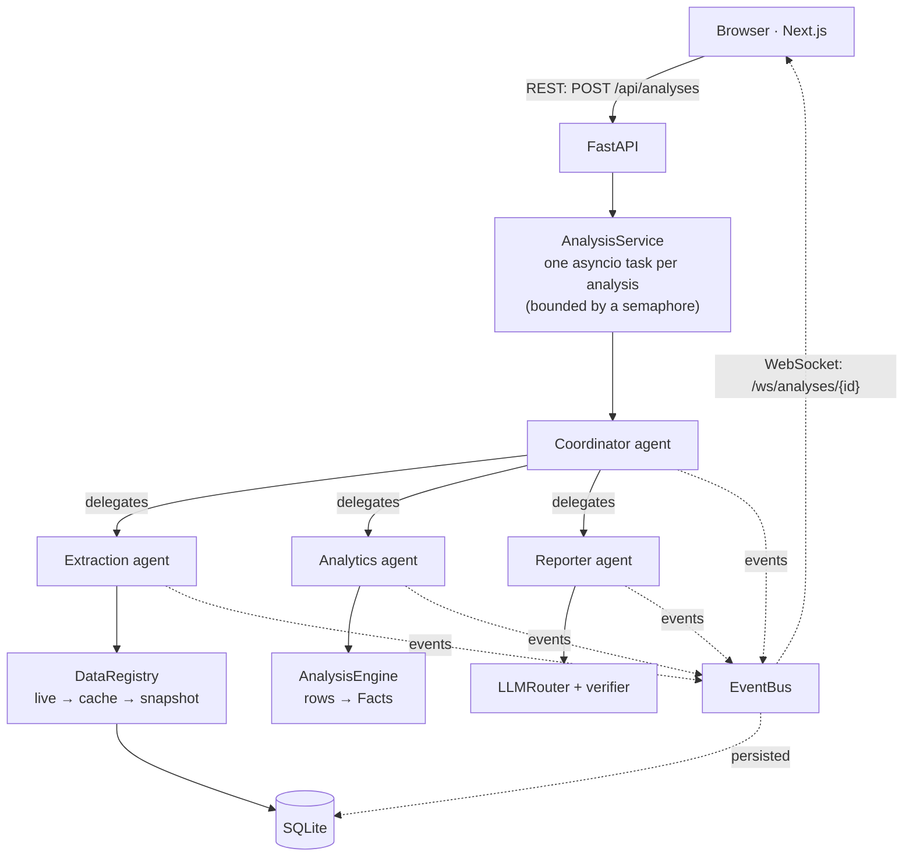

# Architecture

This document explains how the platform turns a research question into a verified, cited report: the components, how a
request flows through them, how the agents make decisions, and how the system stays correct when data sources or LLMs fail.

**Contents**
1. [Core principle](#1-core-principle)
2. [System overview](#2-system-overview)
3. [Request lifecycle](#3-request-lifecycle)
4. [Agent design](#4-agent-design)
5. [Data layer](#5-data-layer)
6. [Analytics: from rows to facts](#6-analytics-from-rows-to-facts)
7. [LLM layer](#7-llm-layer)
8. [Hallucination defence](#8-hallucination-defence)
9. [Database schema](#9-database-schema)
10. [Design decisions and trade-offs](#10-design-decisions-and-trade-offs)
11. [Security and observability](#11-security-and-observability)

---

## 1. Core principle

> **Code computes, the LLM narrates, a verifier checks.**

| Role | Who | What it may do |
|---|---|---|
| Compute | `AnalysisEngine` (pandas / scipy) | Produce every number, as a typed `Fact` with its sources |
| Narrate | LLM (or the offline model) | Interpret the question, choose the next tool, write prose *about* facts |
| Check | `reporting/verify.py` | Reject any prose containing a number, year or source it cannot trace to a cited fact |

The LLM never supplies a number. That single rule is what makes the reports trustworthy, and most of the design below
exists to enforce it.

---

## 2. System overview



| Layer | Main modules | Responsibility |
|---|---|---|
| API | `api/routes.py`, `api/ws.py` | REST endpoints, WebSocket event stream, validation, rate limiting |
| Orchestration | `service.py`, `events.py` | Run analyses as background tasks, enforce concurrency and timeouts, fan out events |
| Agents | `agents/` | Coordinator, Extraction, Analytics, Reporter on a shared ReAct loop (`base.py`) |
| Data | `datasources/`, `data_quality.py`, `ontology.py` | Fetch, cache, normalise and quality-check government data |
| Analytics | `analytics/` | Statistics and `Fact` generation |
| LLM | `llm/` | Provider adapters, ordered fallback, circuit breakers, cost tracking |
| Reporting | `reporting/` | Drafting, verification, report composition and export (MD / HTML / JSON / CSV) |
| Storage | `db.py` | SQLite (WAL mode) |

---

## 3. Request lifecycle

1. **Submit.** `POST /api/analyses` validates the question, applies a per-IP rate limit (`RATE_LIMIT_PER_MIN`), stores a
   `queued` row and starts a background task. It returns `202 {id}` immediately, so the client never waits on a long analysis.
2. **Run.** The task waits for a free slot (`MAX_CONCURRENT_ANALYSES`), then runs the Coordinator under a 240 s overall
   timeout. The final result document is saved to the `analyses` table.
3. **Stream.** Every agent step is emitted as an `Event` (`status`, `thought`, `action`, `observation`, `delegation`,
   `warning`, `llm`, `result`, `done`). Each event is saved to SQLite and pushed to live subscribers.
4. **Watch.** The UI opens `WS /ws/analyses/{id}`. The socket **subscribes first, then replays history**, and skips any
   event whose sequence number it has already sent, so nothing is lost or duplicated at the hand-over. If the socket
   drops, the UI falls back to polling `GET /api/analyses/{id}/events?after=<seq>`.
5. **Finish or stop.** A run ends in one of these states: `completed`, `degraded` (shown as *Completed with fallbacks*),
   `needs_clarification`, `incomplete`, `failed` or `cancelled` (`POST /api/analyses/{id}/cancel`).
6. **Recover.** On startup, any analysis left `queued` or `running` by a crashed process is marked `failed` with the
   reason "Interrupted by a server restart", so the history never shows a run that will never finish.

---

## 4. Agent design

### 4.1 The ReAct loop (`agents/base.py`)

All four agents share one loop. Each iteration:

1. **Reason.** Build a prompt from the goal, the available tools, a compact summary of the current state and the last 4 steps.
   Ask the model for JSON: either `{"thought", "action": {tool, args}}` or `{"thought", "final"}`.
2. **Act.** Validate the choice and run the tool.
3. **Observe.** Record the tool's result as an observation the next iteration can reason about.

The loop is built to keep making progress whatever the model does. Each case below has a test in
`tests/unit/test_react_agent.py`.

| If… | Then… |
|---|---|
| The LLM returns invalid JSON or an unknown tool | The router's validator rejects it and tries the next provider. If every provider fails, the agent's **rule-based policy** decides the step (one warning, then the policy runs the rest of that task). |
| A tool raises an error | The error becomes an observation (`ok: false`). The agent can react to it; the workflow does not crash. |
| The agent repeats the same action 3 times | Treated as a loop: the policy overrides that step. |
| The agent tries to finish too early | `can_finish()` rejects it with a reason. After 2 rejections the policy takes over. |
| The agent never finishes | A step budget (14 steps, `AGENT_MAX_STEPS`) ends it as `incomplete`, never a hang. |
| A tool hangs | 120 s per-tool timeout; 240 s per-analysis timeout. |

**Policies** (`agents/policies.py`) are pure `state → decision` functions. They play two roles:
- the "brain" of the **offline model**, so the platform runs end-to-end with no API keys;
- a **guardrail** for live LLMs, so a misbehaving model can't stall a workflow.

A live LLM sees exactly the same state and tools as the policy, and is free to choose differently.

### 4.2 The four agents

| Agent | Tools | Decisions it makes | When things go wrong |
|---|---|---|---|
| **Coordinator** | `interpret_query`, `request_clarification`, `plan_workflow`, `delegate_extraction`, `replan`, `delegate_analytics`, `delegate_reporting` | Ask for clarification or plan the work; after extraction, continue, **re-plan** (drop analyses whose optional data is missing) or abort; set the final status | Asks rather than guesses on an ambiguous question; fails with a stated reason when required data can't be obtained |
| **Extraction** | `search_catalog`, `fetch_datasets`, `use_snapshot`, `skip_datasets`, `validate_and_clean`, `store_datasets` | Which datasets to fetch; **retry once** on a transient error (429 / timeout); otherwise **use the bundled snapshot** (flagged degraded); otherwise **skip** if the dataset is optional; reject a dataset whose schema has changed | Errors are isolated per dataset; a missing *required* dataset with no fallback makes the Coordinator fail the run |
| **Analytics** | `check_scope`, `analyze_trends`, `compare_sectors`, `analyze_relationships`, `cross_source`, `outlook` | Carry out the planned analyses; report `insufficient_data` instead of inventing a result; turn a sector's missing measure into a *limitation* fact | The trend-break check withholds a projection it can't support; no usable analysis → `failed` |
| **Reporter** | `draft_findings`, `verify_draft`, `revise_draft`, `compose_report` | Draft → verify → revise using the verifier's failures as feedback → fall back to a rule-based draft if still failing → compose | An unverifiable narrative is never published |

### 4.3 Interpreting the question safely

1. The LLM proposes a `QueryIntent` as JSON (sectors, measures, years, kind of analysis).
2. Pydantic validates it against the sector/measure **ontology**. A made-up sector id, an impossible year range or an
   instruction injected into the question cannot widen the scope.
3. Years are clamped to the data actually available, and the adjustment is stated in the report as an assumption.
4. If the LLM fails, a deterministic heuristic parser produces the intent instead.

The user's text is always delimited as *data* in prompts, never as instructions.

---

## 5. Data layer

### 5.1 Acquisition (`datasources/registry.py`)

```
DataRegistry.acquire(key):   fresh disk cache (< 24 h) ──miss──►  live API  ──fail──►  DataSourceError(code, retryable)
                                                               (retry/backoff, honours Retry-After)
```

A successful live fetch is written to the cache, so repeated questions within 24 hours don't call the API again. This
also keeps the platform under Data.gov.sg's rate limit: a second run only needs to fetch what the first run missed.
With `LIVE_DATA=false` the bundled snapshots are used directly (not flagged as degraded) and the network is never called.

The bundled snapshot is deliberately **not** an automatic fallback here. The Extraction agent has to choose
`use_snapshot`, so degraded data is always an explicit, visible decision in the event log and the report.

Every dataset carries its **provenance** (mode, retrieval time, degraded flag, licence, URL) into the report's
citations. Source details are in [DATA_SOURCES.md](DATA_SOURCES.md).

### 5.2 Normalisation (`datasources/normalise.py`, `ontology.py`)

Each source is mapped onto one canonical long format, `(year, sector, value, unit)`, through a shared sector ontology.
That is how MOM's "financial and insurance services" and SingStat's "Finance & Insurance" end up as the same sector. A
source that changes its columns raises `SchemaError`, which the Extraction agent handles.

### 5.3 Data quality (`data_quality.py`)

Each dataset is coerced and validated, producing an auditable `DQReport` and a 0–100 score. Checks cover suppression
tokens (e.g. `-`, `na`), thousands separators, invalid years, out-of-range values, duplicates, isolated spikes, gaps
and staleness.

Two policies are deliberate:
- **Conflicting duplicates** (same key, different values) are **both excluded**. The platform never guesses which one is right.
- **Isolated spikes** are flagged but *kept* in official data, because they are often real (COVID), and *quarantined*
  in internal data.

---

## 6. Analytics: from rows to facts

`AnalysisEngine` (`analytics/engine.py`) produces `Fact` objects:

```
Fact(id, kind, sector, metric, period, statement, values{name: (value, kind)},
     sources, caveats, importance, mock)
```

A fact's `statement` and `values` are generated together, and a test asserts that every number in every statement is
accounted for by its own `values`.

Statistical choices that matter (`analytics/stats.py`):

| Analysis | Method | Why |
|---|---|---|
| Correlation | On **year-on-year changes**, not levels | Two growing series always look correlated in levels |
| Anomalies | Median/MAD robust z-score | Not distorted by the anomalies it is looking for |
| Projection | OLS with a prediction interval | Gives an honest range, not a single number |
| Trend break | Withhold the projection when the latest value falls outside the interval implied by the earlier trend | Avoids extrapolating a trend that has just broken |

---

## 7. LLM layer

`LLMRouter.complete()` (`llm/router.py`) tries providers in `LLM_PROVIDER_ORDER` (default
`anthropic, openai, gemini, bedrock, azure, offline`):

- **Skip** providers that have no credentials, and paid providers once the per-analysis **budget** (`LLM_BUDGET_USD`,
  default $0.50) is spent.
- **Circuit breaker** per provider: after 3 consecutive *availability* failures it is skipped for 60 s, then one trial
  call is let through. Invalid *output* falls back for that request but does not open the circuit, because a badly
  formatted answer is not an outage.
- **Retry once** on transient errors (timeout, 429, 5xx).
- **Validate** every response. A schema, ontology or format violation counts as a provider failure and falls through
  to the next provider.
- **Record** every attempt, success or failure, in `llm_calls` with tokens, estimated cost and latency.

| Provider | Adapter | API |
|---|---|---|
| Anthropic Claude | `providers/anthropic.py` | Messages API via the official `anthropic` SDK; `claude-opus-5-5`, effort `ANTHROPIC_EFFORT`, server-side refusal fallback (`fallbacks: "default"`) |
| OpenAI | `providers/openai.py` | Chat Completions |
| Azure OpenAI | `providers/azure.py` | Deployment URL + `api-key` |
| Google Gemini | `providers/gemini.py` | `generateContent` |
| AWS Bedrock | `providers/bedrock.py` | Converse API |
| Offline | `providers/offline.py` | Rule-based policies; always last, never paid |

---

## 8. Hallucination defence

`reporting/verify.py` checks every narrative item before it can be published:

| Check | Example of what is caught |
|---|---|
| Citations | A finding that cites an unknown fact id, or cites none |
| **Every number** | Typed matching: a `%` must match a percentage fact; "S$42.8 billion" is converted to S$ million; "139.2k" to persons; rounding tolerance follows the decimals written |
| Years | A year outside the data's coverage |
| Sources | Naming an agency that was never used (IRAS, IMF, World Bank…) |
| Mock data | Narrating a MOCK (synthetic) fact without saying so |
| Causal language | "caused by", "driven by"… on correlational evidence (warning only) |

Derived values (a difference or % change between two cited values) are allowed and tagged as derived.

If errors are found: **revise** with the failures as feedback → if still failing, use the **rule-based draft**. The
measured detection rates are in [TESTING.md](TESTING.md).

---

## 9. Database schema

SQLite in WAL mode (`db.py`). Column-by-column details, JSON shapes, example rows and inspection queries are in
[DATABASE.md](DATABASE.md).

```
analyses      id PK, query, status, options, title, error, result JSON, facts, duration_ms,
              created_at, updated_at, completed_at

events        id PK, analysis_id, seq, ts, agent, type, message, data JSON
              UNIQUE(analysis_id, seq)

datasets      key PK, source, title, mode, degraded, is_mock, retrieved_at, rows, dq_score,
              dq JSON, provenance JSON, updated_at

dataset_rows  dataset_key, year, sector, sector_label, metric, value, unit      -- cleaned canonical rows

llm_calls     id PK, analysis_id, ts, agent, task, provider, model, input_tokens, output_tokens,
              cost_usd, latency_ms, ok, error
```

---

## 10. Design decisions and trade-offs

| Decision | Why | Cost / what changes in production |
|---|---|---|
| Custom ReAct loop instead of LangGraph | Few dependencies, full control over guardrails | No built-in checkpointing or graph visualisation. Porting is mechanical: tools and policies are already plain functions. |
| SQLite + in-process tasks | Zero setup | Single node. Production: Postgres (swap `Database`), a queue (SQS / Celery) with stateless workers, Redis pub/sub for the event bus so WebSockets scale horizontally. |
| Offline policy as the fallback model | Deterministic, key-free demos and tests | Plans less flexibly than a strong LLM; live LLMs get the same state and tools. |
| Annual data only | Simpler, consistent joins across sources | MOM also publishes quarterly series; the catalog/normaliser extends to them (a period column instead of year). |
| Resident-only employment | That is what MOM's industry series cover (citizens + PRs) | Foreign-workforce datasets would complete the picture; disclosed as a caveat on every employment fact. |
| The LLM sees facts, not raw rows | Minimises data leaving the boundary | Good fit for sensitive deployments (see [INNOVATION.md](INNOVATION.md)). |

---

## 11. Security and observability

**Security**
- Secrets are runtime environment variables only: never baked into images, never logged.
- Containers run as a non-root user.
- The API validates and length-limits input and rate-limits submissions per IP.
- Fault injection (the failure demo) can be switched off with `ALLOW_FAULT_INJECTION=false`.
- The question is treated as data in prompts, and LLM output can only select ontology ids.
- **There is no authentication in this prototype.** Put it behind SSO or an API gateway before exposing it.

**Observability**
- Structured logs with request ids.
- A per-analysis event log (the same events the UI shows).
- Per-provider status, call counts and failures at `GET /api/providers`.
- Per-call cost and latency in `llm_calls`.
