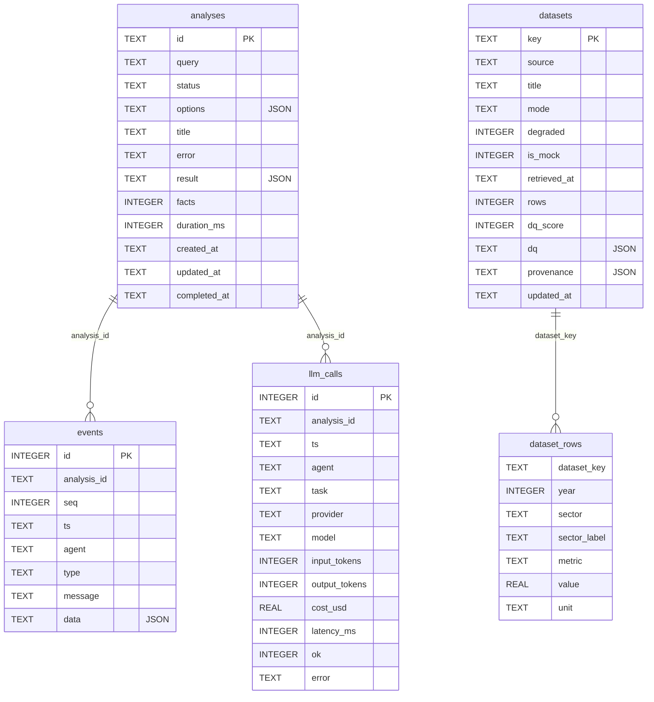

# Database

The platform stores everything in one **SQLite** file: analyses and their results, the live agent event log, the
cleaned government datasets, and a log of every LLM call. This document describes each table, the JSON stored inside
it, who writes it and when, and how to inspect it.

All code is in [`backend/app/db.py`](backend/app/db.py). For how the database fits into the wider system, see
[ARCHITECTURE.md](ARCHITECTURE.md).

**Contents**
1. [At a glance](#1-at-a-glance)
2. [Entity diagram](#2-entity-diagram)
3. [Tables](#3-tables)
4. [JSON columns](#4-json-columns)
5. [Who writes what, and when](#5-who-writes-what-and-when)
6. [Inspecting the database](#6-inspecting-the-database)
7. [Conventions and limits](#7-conventions-and-limits)

---

## 1. At a glance

| | |
|---|---|
| Engine | SQLite 3, **WAL** journal mode (readers don't block the writer) |
| File | `backend/var/platform.db` (from `runtime_dir` in `app/config.py`; a volume in Docker) |
| Schema creation | `CREATE TABLE IF NOT EXISTS` on startup. There is no migration tool. |
| Access | One shared connection guarded by a re-entrant lock; each write runs in a transaction |
| Tests | Each test gets its own database in a temporary directory, so the suite never touches `var/` |

| Table | Holds | One row per | Example size (local DB) |
|---|---|---|---|
| `analyses` | Each research question and its full result | analysis | 2 |
| `events` | Every agent step, streamed to the UI | event | 193 |
| `datasets` | Metadata, data-quality report and provenance of each dataset | dataset | 10 |
| `dataset_rows` | Cleaned data in one canonical long format | (dataset, year, sector) value | 2,945 |
| `llm_calls` | Every LLM attempt: provider, tokens, cost, latency | attempt | 49 |

---

## 2. Entity diagram



The relationships are **logical**: no `FOREIGN KEY` constraints are declared. Integrity is kept by the code instead.
For example, deleting an analysis removes its events and LLM calls in the same transaction.

The two halves of the schema are independent. `datasets` / `dataset_rows` are **not** linked to an analysis. They hold
the latest cleaned copy of each dataset, shared by all analyses. What a particular analysis used is recorded inside its
own `analyses.result` JSON (its `datasets` and `data_quality` keys), so old results stay accurate after a dataset is refreshed.

---

## 3. Tables

### 3.1 `analyses`

One row per research question. The row is created as `queued` and updated as the run progresses.

| Column | Type | Null | Description |
|---|---|---|---|
| `id` | TEXT | PK | 12-character hex id, e.g. `1fbd131d93b9` |
| `query` | TEXT | no | The question, whitespace-normalised (3–600 characters) |
| `status` | TEXT | no | Run state; see the table below |
| `options` | TEXT (JSON) | no, default `{}` | Run options. Currently only simulated faults: `{"faults": ["source:mom:rate_limited"]}` |
| `title` | TEXT | yes | Report title, copied from `result.report.title` when the run finishes |
| `error` | TEXT | yes | Why the run failed or stopped |
| `result` | TEXT (JSON) | yes | The full result document; see [4.1](#41-analysesresult) |
| `facts` | INTEGER | default 0 | Number of facts produced (for the history list, without parsing `result`) |
| `duration_ms` | INTEGER | yes | Run time |
| `created_at` / `updated_at` / `completed_at` | TEXT | `completed_at` yes | ISO-8601 UTC timestamps with milliseconds |

Index: `idx_analyses_created` on `created_at DESC` (the history list is newest first).

**Status values**

| Status | Meaning | Final? |
|---|---|---|
| `queued` | Accepted, waiting for a free worker slot | no |
| `running` | Agents are working | no |
| `completed` | Finished with live (or cached) data | yes |
| `degraded` | Finished, but some data came from bundled snapshots or optional data was skipped. The UI shows *Completed with fallbacks*. | yes |
| `needs_clarification` | The question was too ambiguous; `result.clarification` says what to ask | yes |
| `failed` | Required data was unavailable, the run timed out, or the server restarted mid-run | yes |
| `cancelled` | Stopped with `POST /api/analyses/{id}/cancel` | yes |
| `incomplete` | Rare: the Coordinator used up its step budget after a report already existed | yes |

On startup, any row still `queued` or `running` is set to `failed` with the error *"Interrupted by a server restart"*.

### 3.2 `events`

The agent activity log. These are the same events the UI shows live over the WebSocket, so a finished analysis can be
replayed exactly.

| Column | Type | Description |
|---|---|---|
| `id` | INTEGER PK | Auto-increment |
| `analysis_id` | TEXT | → `analyses.id` |
| `seq` | INTEGER | 1, 2, 3… within one analysis. Used by clients to resume (`?after=<seq>`) and to drop duplicates. |
| `ts` | TEXT | ISO-8601 UTC timestamp |
| `agent` | TEXT | `system`, `coordinator`, `extraction`, `analytics` or `reporter` |
| `type` | TEXT | `status`, `thought`, `action`, `observation`, `delegation`, `warning`, `llm`, `result`, `done`, `error` |
| `message` | TEXT | Human-readable line shown in the timeline |
| `data` | TEXT (JSON) | Structured details; see [4.2](#42-eventsdata) |

Index: `idx_events_seq`, **unique** on `(analysis_id, seq)`, so the same step can never be stored twice.

Example: part of a run with a simulated MOM rate limit:

| seq | agent | type | message |
|---|---|---|---|
| 5 | coordinator | action | `interpret_query()` |
| 7 | coordinator | observation | Intent: trend \| sectors: ict \| measures: standard bundle \| 2020-2024 |
| 16 | coordinator | delegation | Delegating to the Data Extraction agent |
| 24 | extraction | observation | Fetched 2/10 dataset(s); failed: mom.employed_residents (rate_limited), … |
| 31 | extraction | action | `use_snapshot(keys=["mom.employed_residents", …])` |
| 32 | extraction | warning | mom.employed_residents: using bundled snapshot retrieved 2026-10-30 (live source unavailable) |
| 52 | coordinator | observation | Extraction degraded: 10 datasets ready, 8 degraded, 0 skipped |

### 3.3 `datasets`

One row per dataset, describing the latest cleaned copy. It is replaced (`INSERT OR REPLACE`) each time an analysis
stores that dataset.

| Column | Type | Description |
|---|---|---|
| `key` | TEXT PK | `<source>.<name>`, e.g. `mom.job_vacancies` |
| `source` | TEXT | `mom`, `singstat` or `internal` |
| `title` | TEXT | The publisher's title |
| `mode` | TEXT | How it was obtained: `live`, `cache`, `snapshot` (bundled file) or `internal` (mock Excel file) |
| `degraded` | INTEGER 0/1 | 1 = a fallback was used because the live source failed |
| `is_mock` | INTEGER 0/1 | 1 = synthetic data (the internal Excel file) |
| `retrieved_at` | TEXT | When the data was fetched from the publisher |
| `rows` | INTEGER | Number of cleaned rows in `dataset_rows` |
| `dq_score` | INTEGER | Data-quality score, 0–100 |
| `dq` | TEXT (JSON) | Full data-quality report; see [4.3](#43-datasetsdq) |
| `provenance` | TEXT (JSON) | Where the data came from; see [4.4](#44-datasetsprovenance) |
| `updated_at` | TEXT | When this row was last written |

The 10 datasets in the local DB:

| key | source | mode | rows | DQ score | years | unit |
|---|---|---|---|---|---|---|
| `mom.employed_residents` | MOM | snapshot | 224 | 100 | 2010–2025 | persons |
| `mom.job_vacancies` | MOM | snapshot | 420 | 95 | 1998–2025 | persons |
| `mom.job_vacancy_rate` | MOM | snapshot | 420 | 100 | 1998–2025 | % |
| `mom.recruitment_rate` | MOM | snapshot | 420 | 95 | 1998–2025 | % |
| `mom.resignation_rate` | MOM | snapshot | 420 | 95 | 1998–2025 | % |
| `mom.retrenchments` | MOM | snapshot | 419 | 95 | 1998–2025 | persons |
| `mom.total_wage_change` | MOM | snapshot | 214 | 96 | 2001–2024 | % |
| `mom.unemployment_rate` | MOM | snapshot | 34 | 100 | 1992–2025 | % (economy-wide) |
| `singstat.gdp_by_industry` | SingStat | snapshot | 334 | 100 | 2000–2025 | S$ million |
| `internal.tech_programmes` | internal (MOCK) | internal | 40 | 67 | 2018–2025 | persons |

### 3.4 `dataset_rows`

The cleaned data, in one canonical **long** format shared by every source: one value per dataset, year and sector.
This is what lets MOM and SingStat figures for the same sector be compared directly.

| Column | Type | Description |
|---|---|---|
| `dataset_key` | TEXT | → `datasets.key` |
| `year` | INTEGER | Calendar year |
| `sector` | TEXT, nullable | Ontology sector id (e.g. `ict`, `finance`). `NULL` for economy-wide series such as the unemployment rate. |
| `sector_label` | TEXT | The publisher's own label for that sector |
| `metric` | TEXT | Measure name, e.g. `employed_residents` |
| `value` | REAL | The value, in `unit` |
| `unit` | TEXT | `persons`, `%` or `S$ million` |

Index: `idx_rows_key` on `dataset_key`. When a dataset is stored, all its old rows are deleted and the new ones
inserted in the same transaction, so readers never see a half-written dataset.

Example: ICT employed residents:

| dataset_key | year | sector | sector_label | metric | value | unit |
|---|---|---|---|---|---|---|
| mom.employed_residents | 2020 | ict | information and communications | employed_residents | 111600 | persons |
| mom.employed_residents | 2021 | ict | information and communications | employed_residents | 120300 | persons |
| mom.employed_residents | 2022 | ict | information and communications | employed_residents | 132900 | persons |
| mom.employed_residents | 2023 | ict | information and communications | employed_residents | 136100 | persons |
| mom.employed_residents | 2024 | ict | information and communications | employed_residents | 139200 | persons |

### 3.5 `llm_calls`

One row per LLM **attempt**, successful or not, including fallbacks. It is the source for cost tracking and the
per-provider stats.

| Column | Type | Description |
|---|---|---|
| `id` | INTEGER PK | Auto-increment |
| `analysis_id` | TEXT, nullable | → `analyses.id` |
| `ts` | TEXT | ISO-8601 UTC timestamp |
| `agent` | TEXT | Which agent made the call |
| `task` | TEXT | Purpose, e.g. `react_step`, `interpret_query` |
| `provider` / `model` | TEXT | e.g. `openai` / `gpt-4o-mini`, or `offline` / `offline` |
| `input_tokens` / `output_tokens` | INTEGER | Token counts (estimated for the offline model) |
| `cost_usd` | REAL | Estimated cost from `llm/pricing.py`; always 0 for `offline` |
| `latency_ms` | INTEGER | Call duration |
| `ok` | INTEGER 0/1 | 0 = failed (error, timeout or invalid output) |
| `error` | TEXT | Error message when `ok = 0`, otherwise empty |

Example:

| analysis_id | agent | task | provider | in | out | cost | latency | ok |
|---|---|---|---|---|---|---|---|---|
| 1fbd131d93b9 | coordinator | react_step | offline | 211 | 40 | 0.0 | 0 | 1 |
| 1fbd131d93b9 | coordinator | interpret_query | offline | 20 | 87 | 0.0 | 3 | 1 |

---

## 4. JSON columns

SQLite stores these as TEXT. The code writes them with `json.dumps` and reads them with `json.loads`.

### 4.1 `analyses.result`

The complete output of a run. The API returns it unchanged from `GET /api/analyses/{id}`, and the exports are built from it.

| Key | Contents |
|---|---|
| `status`, `error`, `query`, `duration_ms` | Run summary |
| `intent` | Interpreted question: `kind`, `sectors`, `metrics`, `start_year`, `end_year`, `forecast_horizon`, `assumptions`… |
| `plan` | Required and optional datasets, and the analysis steps |
| `clarification` | The question to ask the user, when `status = needs_clarification` |
| `datasets`, `skipped_datasets` | Provenance of each dataset used, and any skipped with the reason |
| `data_quality` | The DQ report for each dataset as it was **at the time of this run** |
| `facts` | Every computed fact (example below) |
| `charts` | Chart specs the UI renders |
| `report` | The verified narrative report (title, executive summary, findings, implications, recommendations, limitations) |
| `verification` | Hallucination-check result: `passed`, `numbers_checked`, `grounding_score`, `issues`, `revisions`… |
| `llm` | Usage: `calls`, `failed_attempts`, tokens, `cost_usd`, `by_provider`, `fallback_events` |
| `warnings` | Warnings raised during the run |
| `stages` | Status of each stage, e.g. `{"extraction": "degraded", "analytics": "ok", "reporting": "ok"}` |

Example fact:

```json
{
  "id": "F1",
  "kind": "growth",
  "sector": "ict",
  "metric": "employed_residents",
  "period": [2020, 2024],
  "statement": "Information & Communications: employed residents rose from 111,600 in 2020 to 139,200 in 2024 (+24.7% overall; 5.7% a year compounded).",
  "values": {
    "start_year": { "v": 2020, "kind": "year" },
    "end_year": { "v": 2024, "kind": "year" },
    "start": { "v": 111600.0, "kind": "count" },
    "end": { "v": 139200.0, "kind": "count" },
    "pct_change": { "v": 24.73, "kind": "pct" },
    "cagr": { "v": 5.68, "kind": "pct" }
  },
  "sources": ["mom.employed_residents"],
  "caveats": ["Counts employed residents (citizens and permanent residents) only; foreign workers are excluded."]
}
```

### 4.2 `events.data`

The shape depends on the event `type`:

| type | `data` example |
|---|---|
| `action` | `{"tool": "fetch_datasets", "args": {"keys": [...]}, "step": 2}` |
| `observation` | `{"tool": "fetch_datasets", "ok": true, "result": {"summary": "..."}, "step": 2}` (long results are stored as `{"truncated": "..."}`) |
| `delegation` | `{"to": "extraction", "datasets": ["mom.employed_residents", ...]}` |
| `llm` | `{"provider": "offline", "model": "offline", "tokens_in": 211, "tokens_out": 40, "cost_usd": 0.0, "latency_ms": 0, "fallbacks": 0}` |
| `done` | `{"status": "degraded"}` |
| `status`, `thought`, `warning` | Often `{}` or `{"step": n}`; the text is in `message` |

### 4.3 `datasets.dq`

The data-quality report for the latest cleaning of that dataset:

```json
{
  "dataset_key": "mom.total_wage_change",
  "rows_in": 216,
  "rows_out": 214,
  "completeness": 0.9907,
  "score": 96,
  "year_min": 2001,
  "year_max": 2024,
  "sectors": 9,
  "issues": [
    {
      "code": "conflicting_duplicates",
      "severity": "warning",
      "message": "2 rows share a key but disagree, so neither can be trusted",
      "rows": 2,
      "action": "both values excluded - verify with the source agency",
      "examples": ["Construction 2023: 4.2", "..."]
    }
  ]
}
```

Issue codes seen in the local data include `normalised`, `missing_values`, `invalid_year`, `out_of_domain`,
`duplicate_rows`, `conflicting_duplicates`, `isolated_spike`, `aggregated` and `mock_data`. Severity is `info`,
`warning` or `error`.

### 4.4 `datasets.provenance`

Where the data came from. It is copied into the report's citations.

```json
{
  "dataset_key": "mom.total_wage_change",
  "source": "mom",
  "source_name": "Ministry of Manpower (via Data.gov.sg)",
  "title": "Total Wage (Nominal) Changes by Industry",
  "dataset_id": "d_e5848828d6a14d35a8b7eea7e15a149e",
  "url": "https://data.gov.sg/datasets/d_e5848828d6a14d35a8b7eea7e15a149e/view",
  "fmt": "csv",
  "retrieved_at": "2026-10-30T06:32:42+00:00",
  "mode": "snapshot",
  "degraded": false,
  "is_mock": false,
  "licence": "Singapore Open Data Licence v1.0",
  "notes": []
}
```

When a snapshot is used as a fallback, `notes` says so, e.g. *"bundled snapshot retrieved 2026-10-30T06:32:08+00:00;
live source was unavailable so results may lag the latest release"*.

---

## 5. Who writes what, and when

| Moment | Write | Method in `db.py` |
|---|---|---|
| `POST /api/analyses` | Insert `analyses` row as `queued` | `create_analysis` |
| A worker slot frees up | `status = running` | `set_status` |
| Every agent step | Insert into `events` (next `seq`) | `add_event` |
| Every LLM attempt | Insert into `llm_calls` | `add_llm_call` |
| Extraction agent's `store_datasets` | Replace the `datasets` row and all its `dataset_rows` | `store_dataset` |
| Run finishes, fails, times out or is cancelled | Save `status`, `result`, `error`, `title`, `facts`, `duration_ms`, `completed_at` | `save_result` |
| `DELETE /api/analyses/{id}` (the **×** in the history list) | Delete the analysis and its events and LLM calls | `delete_analysis` |
| Server startup | Mark leftover `queued` / `running` rows `failed` | `fail_orphans` |

Deleting an analysis does **not** delete datasets, because they are shared by all analyses.

---

## 6. Inspecting the database

### Through the API (while the backend is running)

| Endpoint | Returns |
|---|---|
| `GET /api/analyses` | History list (no `result`), newest first |
| `GET /api/analyses/{id}` | One analysis, including the full `result` |
| `GET /api/analyses/{id}/events?after=0` | Its event log |
| `GET /api/datasets` | Every dataset's metadata and DQ score |
| `GET /api/datasets/{key}/rows?limit=200` | Cleaned rows of one dataset (max 2,000) |
| `GET /api/providers` | Per-provider stats, including circuit-breaker state |

### With the `sqlite3` command line

Open it read-only so you can't change anything by accident:

```bash
sqlite3 -readonly backend/var/platform.db
```

Useful queries:

```sql
-- Recent analyses
SELECT id, status, facts, duration_ms, created_at, substr(query, 1, 60) AS query
FROM analyses ORDER BY created_at DESC LIMIT 10;

-- Replay one analysis's agent log
SELECT seq, agent, type, message FROM events WHERE analysis_id = '<id>' ORDER BY seq;

-- Dataset health
SELECT key, mode, degraded, is_mock, rows, dq_score FROM datasets ORDER BY dq_score;

-- Every data-quality issue, one per line (uses SQLite's JSON functions)
SELECT d.key, json_extract(i.value, '$.severity') AS severity, json_extract(i.value, '$.message') AS message
FROM datasets d, json_each(d.dq, '$.issues') i;

-- LLM usage and cost by provider
SELECT provider, model, COUNT(*) AS calls, SUM(1 - ok) AS failed,
       SUM(input_tokens) AS tokens_in, SUM(output_tokens) AS tokens_out,
       ROUND(SUM(cost_usd), 4) AS cost_usd
FROM llm_calls GROUP BY provider, model;

-- Compare one measure across sectors
SELECT sector, year, value FROM dataset_rows
WHERE dataset_key = 'mom.job_vacancy_rate' AND year >= 2020 ORDER BY sector, year;
```

### Resetting

Stop the backend, then delete `backend/var/platform.db` and its `-wal` / `-shm` files. A fresh, empty database is
created on the next start. The HTTP cache in `backend/var/http-cache/` is separate and can be kept.

---

## 7. Conventions and limits

**Conventions**
- Timestamps are ISO-8601 UTC strings with milliseconds (`2026-11-11T07:08:32.713+00:00`), so text order is time order.
- Booleans are `INTEGER` 0/1.
- JSON is stored as `TEXT` and can be queried with SQLite's `json_extract` / `json_each`.

**Limits of the prototype, and what changes in production**

| Now | Production |
|---|---|
| SQLite on a single node, one connection with a lock | PostgreSQL (swap the `Database` class); JSON columns become `JSONB` |
| No foreign keys; deletes cascade in code | Declare foreign keys with `ON DELETE CASCADE` |
| Schema created on startup, no migrations | A migration tool such as Alembic |
| `datasets` keeps only the latest copy of each dataset | Version datasets (add a version or `retrieved_at` to the key) so an old run can be re-run on exactly the same data |
| `events` and `llm_calls` grow forever | A retention policy, or archiving old runs |
