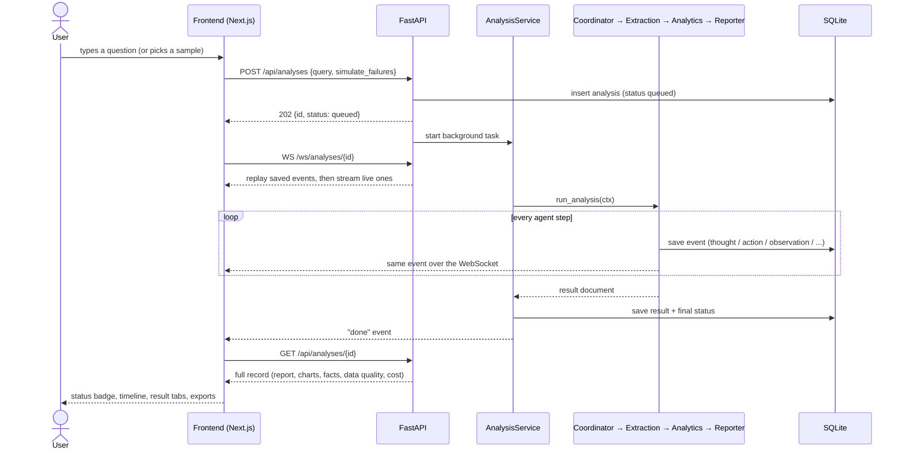

# Workflow

This document follows one question from the moment it is typed into the UI until the report is on screen: what the
frontend does, what the backend does, and how the two stay in step. For the reasons behind the design, see
[ARCHITECTURE.md](ARCHITECTURE.md); for hosting, see [docs/DEPLOYMENT.md](docs/DEPLOYMENT.md).

**Contents**
1. [The whole flow at a glance](#1-the-whole-flow-at-a-glance)
2. [Frontend workflow](#2-frontend-workflow)
3. [Backend workflow](#3-backend-workflow)
4. [Statuses](#4-statuses)
5. [Failure paths](#5-failure-paths)
6. [Where it runs](#6-where-it-runs)

---

## 1. The whole flow at a glance

The API never makes the browser wait for an analysis: it answers `202` straight away and the work continues in the
background. The browser learns about progress from the event stream and fetches the finished result once.

---

## 2. Frontend workflow

Code: `frontend/src/`. One page (`app/page.tsx`) holds all the state; two hooks talk to the backend.

### 2.1 Page load
1. `GET /api/samples` fills the sample-question chips.
2. `GET /api/analyses?limit=30` and `GET /api/providers` load the history sidebar and the LLM provider bar. These two
   reload after every submit or delete and whenever a run finishes.
3. Nothing is selected, so only the question form is shown.

### 2.2 Asking a question (`components/QueryForm.tsx`)
1. The user types a question or clicks a sample. Under *Demo: simulate a failure* they can pick a fault to inject
   (MOM rate-limited, SingStat schema drift, internal database down, an LLM outage, every LLM down).
2. `api.createAnalysis(query, simulate)` sends `POST /api/analyses`.
3. On `202` the page selects the new id, which starts the two hooks below. On `429` it shows "You're sending questions
   too quickly"; any other error shows the API's message.
4. While the run is active the form is disabled and a **Cancel** button calls `POST /api/analyses/{id}/cancel`.

### 2.3 Watching the run (`hooks/useAnalysisStream.ts`)
1. Opens `WS /ws/analyses/{id}`. The server first replays every saved event, then pushes new ones as they happen.
2. Each event has a sequence number; the hook ignores `ping` frames and any event it has already seen.
3. If the socket cannot connect or drops before the run ends, the hook switches to polling
   `GET /api/analyses/{id}/events?after=<last seq>` every second, so the timeline never freezes. The timeline shows
   which transport is in use.
4. A `done` event marks the stream finished.
5. `components/AgentTimeline.tsx` renders the events per agent: thoughts, tool calls, observations, delegations,
   warnings and LLM calls.

### 2.4 Loading the result (`hooks/useAnalysis.ts`)
1. Fetches `GET /api/analyses/{id}` when the analysis is selected.
2. Fetches it again when the stream reports `done`.
3. As a safety net, re-fetches every 3 s until the record reaches a final status.

### 2.5 Showing the outcome (`app/page.tsx`, `components/ResultTabs.tsx`)
| Record status | What the user sees |
|---|---|
| `needs_clarification` | The agent's question and suggested rewordings; clicking one submits it as a new analysis |
| `failed` | An error line with the reason |
| `degraded` | A *Completed with fallbacks* notice listing the warnings, then the report |
| `completed` / `degraded` | Result tabs: **Summary**, **Charts**, **Data quality**, **Sources**, **Facts**, **Trust & cost** |

Exports (Markdown, HTML, JSON, facts CSV) are plain links to `GET /api/analyses/{id}/export?format=...`.
Charts are drawn with Recharts from the chart specs the backend sends (`lib/charts.ts`), so the UI and the exports use
the same data.

### 2.6 History
Clicking an item in the sidebar selects that analysis; the same two hooks replay its events and load its record.
Deleting calls `DELETE /api/analyses/{id}` (which also cancels it if it is still running) and refreshes the list.

---

## 3. Backend workflow

Code: `backend/app/`.

### 3.1 Request handling (`api/routes.py`, `service.py`)
1. `POST /api/analyses` validates the body, applies the per-IP rate limit (`RATE_LIMIT_PER_MIN`) and calls
   `AnalysisService.submit`.
2. `submit` normalises whitespace, merges any requested faults (only if `ALLOW_FAULT_INJECTION`), creates the
   `analyses` row as `queued`, starts an asyncio task and returns `{id, status: "queued"}`.
3. The task waits for a free slot (`MAX_CONCURRENT_ANALYSES`), marks the row `running`, builds a `RunContext`
   (query, settings, data registry, LLM router, faults, event emitter, per-analysis cost tracker) and runs
   `run_analysis` under a time limit (`ANALYSIS_TIMEOUT_S`, 240 s by default).
4. Whatever happens - success, cancellation, timeout or a crash - the task saves a final status and emits `done`, so
   no analysis is left stuck in `running`.

### 3.2 Events (`events.py`, `api/ws.py`)
Every agent step calls `emit(agent, type, message, data)`. The event is written to the `events` table with the next
sequence number and published to any WebSocket subscribed to that analysis. The WebSocket handler subscribes **before**
replaying saved events and drops anything it has already sent, so a client joining mid-run misses nothing and sees
nothing twice. It sends a `ping` every 25 s when idle.

### 3.3 The agent loop (`agents/base.py`, `agents/policies.py`)
All four agents run the same ReAct loop:

1. Build the agent's current **state** (what is done, what is pending).
2. Ask the LLM for the next step as JSON: a `thought` plus either one tool `action` or a `final` answer. The reply is
   validated; an invalid reply or unknown tool makes the router try the next provider.
3. Run the tool (120 s limit). Tool errors and timeouts come back as observations the agent can react to, not crashes.
4. Record the observation and repeat, up to the agent's step budget.

Each agent also has a rule-based **policy**: a pure function from state to the next step. It is used:
* as the whole "model" when no LLM is configured (the offline provider answers with it);
* for the rest of a task once every LLM provider has failed;
* to break a loop (the same action three times in a row);
* after the agent tries to finish too early twice.

### 3.4 Coordinator (`agents/coordinator.py`)
| Step | Tool | What it does |
|---|---|---|
| 1 | `interpret_query` | LLM turns the question into a structured intent (kind, sectors, measures, years), validated against the sector/measure ontology; falls back to a rule-based parser |
| 2 | `request_clarification` | Only if the intent is too vague: stores a question and suggestions, and the run ends as `needs_clarification` |
| 3 | `plan_workflow` | Builds the plan: required datasets, optional datasets and the analysis steps |
| 4 | `delegate_extraction` | Runs the Extraction agent; result is `ok`, `degraded`, `partial` or `failed` |
| 5 | `replan` | Only if optional datasets were skipped: rebuilds the plan without the analyses that needed them |
| 6 | `delegate_analytics` | Runs the Analytics agent |
| 7 | `delegate_reporting` | Runs the Reporter agent |
| 8 | `final` | Finishes. Whether the run is `completed` or `degraded` is worked out from what the stages reported, not from the model's wording |

If required data cannot be obtained, or analytics produces no findings, the Coordinator finishes as `failed` with
the reason.

### 3.5 Extraction (`agents/extraction.py`, `datasources/`, `data_quality.py`)
| Step | Tool | What it does |
|---|---|---|
| 1 | `search_catalog` | Confirms the planned datasets exist in the catalog |
| 2 | `fetch_datasets` | Fetches datasets two at a time: live source → 24 h disk cache → (on failure) error recorded |
| 3 | `fetch_datasets` (retry) | Retries a dataset once after a short pause if the error was temporary (e.g. HTTP 429) |
| 4 | `use_snapshot` | If the live source stays down, loads the bundled snapshot of the real data and marks it **degraded** |
| 5 | `skip_datasets` | Skips an optional dataset with no snapshot; a missing required dataset fails the run |
| 6 | `validate_and_clean` | Column check, type conversion, duplicates, value ranges, outliers; scores data quality. A changed schema rejects the dataset (and the snapshot is tried) |
| 7 | `store_datasets` | Saves the cleaned rows to SQLite |

The agent cannot finish while any dataset is still pending, failed, unvalidated or unsaved.

### 3.6 Analytics (`agents/analytics_agent.py`, `analytics/`)
1. `check_scope` reports which sectors and years each dataset actually covers.
2. It then runs each planned step in order: trends, sector comparison and ranking, relationships (correlation of
   year-on-year changes), the cross-source productivity join (SingStat GDP ÷ MOM employment) and the outlook
   (a projection, withheld when the latest point breaks the trend).
3. Every result is stored as a numbered **fact** (`F1`, `F2`, ...) with typed values, its period and its source
   datasets, plus a chart spec. Code computes every number; the LLM never does.

The agent cannot finish while planned steps remain.

### 3.7 Reporter (`agents/reporter.py`, `reporting/`)
The policy's order is:

1. `draft_findings` - the LLM writes findings and implications, citing fact ids.
2. `verify_draft` - every number, year, citation and source name is checked against the cited facts
   (`reporting/verify.py`).
3. `revise_draft` - if the check fails, the LLM gets one retry with the exact failures as feedback; if that also
   fails, the narrative is replaced by the rule-based draft built directly from the facts.
4. `compose_report` - the LLM writes the executive summary and recommendations, which are checked too (and replaced
   by the rule-based versions if they fail). A final check runs over the whole narrative and its result is stored as
   `verification`. The report is assembled with citations to each source dataset.

### 3.8 Result (`agents/workflow.py`)
`run_analysis` turns the context into one result document: status, error, intent, plan, datasets (with source,
mode, quality score), skipped datasets, data-quality reports, facts (with citations), charts, report,
verification, LLM usage and cost, warnings and per-stage status. The service saves it and emits `done`.

### 3.9 LLM calls (`llm/router.py`)
Every LLM call from any agent goes through the router, which tries providers in `LLM_PROVIDER_ORDER`:

* skips a paid provider once the analysis has spent `LLM_BUDGET_USD`;
* skips a provider whose circuit breaker is open (too many recent failures);
* on an outage or timeout, records a breaker failure and moves to the next provider;
* on badly formatted output, moves to the next provider without tripping the breaker;
* logs each call (tokens, cost, latency) to `llm_calls` and emits an `llm` event.

The offline provider is always last, so a run can always finish.

---

## 4. Statuses

| Status | Meaning |
|---|---|
| `queued` | Saved, waiting for a free slot |
| `running` | The agents are working |
| `completed` | Report produced with live (or cached) data and no fallbacks |
| `degraded` | Report produced, but a snapshot, a skipped dataset, partial analytics or the rule-based narrative was used; the UI shows *Completed with fallbacks* |
| `needs_clarification` | The question was too vague; no data was touched |
| `failed` | No report: required data unavailable, no findings, time limit hit, or an internal error |
| `cancelled` | Stopped by the user |

On startup, any analysis left `queued` or `running` by a previous process is marked `failed`.

---

## 5. Failure paths

| What fails | Backend response | What the user sees |
|---|---|---|
| A data source rate-limits (429) | Retry once, then use the bundled snapshot | *Completed with fallbacks*; dataset marked snapshot in Sources |
| A source changes its schema | Dataset rejected at validation; snapshot used, or the analyses that need it are dropped | Warning in the timeline and the report |
| An optional source is down | Dataset skipped, plan rebuilt without it | Limitation noted in the report |
| A required source is down with no snapshot | Coordinator stops | `failed` with the reason |
| One LLM provider is down | Router moves to the next provider | `llm` / `warning` events in the timeline |
| Every LLM is down | Agents switch to their rule-based policies; the narrative uses the rule-based draft | Report still produced, marked degraded |
| The LLM writes an unsupported number | One revision, then the rule-based draft | Hallucination-check warnings in the timeline; result in *Trust & cost* |
| The WebSocket drops | Nothing changes on the backend | UI polls the events endpoint every second |
| The run takes longer than 240 s | Task stopped | `failed`: time limit |

---

## 6. Where it runs

| | Local development | Production |
|---|---|---|
| Frontend | `npm run dev` on :3000, calls `NEXT_PUBLIC_API_URL` (default `http://localhost:8000`) | Vercel at https://sgpolicyanalytics.com, calling the OpenShift Route cross-origin (allowed by `CORS_ORIGINS`) |
| Backend | `uvicorn app.main:app --port 8000` | One container on the OpenShift Developer Sandbox; the same image also serves a static build of the UI on its own Route |
| Data and history | `backend/var/` (SQLite + HTTP cache) | `/tmp/policy-analytics` in the pod, lost when the pod restarts |
| LLM | Offline model unless keys are set in `.env` | Claude, then the offline model (`terraform/policy-analytics.tfvars`) |

Production limits: one analysis at a time, 3 new analyses a minute (shared by all visitors, who reach the backend
through one router address), and $0.30 of LLM spend per analysis.
